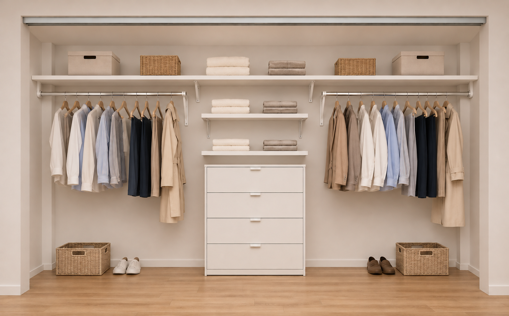

# November 2, 2026 — Bachelor Closet Revised Preferred Layout

## Source

- Source ID: SRC-2026-086
- Type: Chat / design discussion
- Provided by: Homeowner; layout and support proposals by assistant
- Date provided / processed: 2026-11-02
- Related project: New bachelor room — existing closet
- Confidence: Homeowner-reported approximate corner dimensions and planned contractor fabrication; homeowner preference confirmed after viewing the revised preview. Exact construction details remain unverified.
- Status: Revised preferred concept; no furniture purchase, final cut list, price or installation date recorded.
- Earlier source: [Closet measurements and initial concept, SRC-2026-084](2026-11-02-renovation-bachelor-closet-concept.md)

## Conversation Context

- The homeowner proposed extending the upper shelves to the actual side walls, behind the short front returns, and using telescopic rods with wall supports.
- The homeowner reported square wall projections of approximately 5 × 5 inches in the back corners.
- “our contractor will make the shelves himself and will cut the corners and merge I guess.”
- The homeowner proposed a single top shelf with one or two additional shelves underneath in the centre.
- The assistant explained a continuous top shelf could be made from one board or joined sections, depending on material and installation access. Joining was a possibility, not a confirmed contractor method.
- At the homeowner's request, a revised preview was generated with one continuous top shelf, two smaller centre shelves underneath, matching single hanging rods and the rear projections.
- After viewing that preview: “I like it, record that”. The homeowner then authorized the record update with “go”.

## Reported Facts

| Item | Current information |
|---|---|
| Existing closet | Empty and painted; interior 127½ in wide × 79¼ in final clear height × 27–28¾ in deep, from SRC-2026-084 |
| Front | Four sliding panels, no central post or wall; front side returns approximately 5–6½ in each, from SRC-2026-084 |
| Rear corners | Approximately 5 × 5 in square wall projections, understood as one in each rear corner; separate from the front returns. Exact dimensions and vertical extent unmeasured |
| Shelf fabrication | Homeowner says their contractor will make the shelves. Contractor identity, material, price and installation date not supplied |
| Corner fitting | Homeowner expects shelf corners to be cut around the projections; precise notches, joins and fabrication method remain for the contractor to confirm |

## Preferred Revised Concept

- One continuous top shelf across the closet, extending to the true side walls behind the front returns, fitted around the rear corner projections.
- “Continuous” describes the intended appearance and usable surface; a single unbroken board versus joined sections remains undecided.
- Two smaller centre shelves beneath the continuous shelf and above a low four-drawer chest, as shown in the liked preview. One or two was the earlier option; the preview retained here shows two.
- Matching single hanging rods on both sides, with open space beneath for shoes or movable baskets.
- Adjustable / telescopic rods with wall-mounted supports are the proposed approach. Assistant's support concept: outer wall sockets and back-wall shelf-and-rod brackets toward the centre, plus shelf supports as required. Exact hardware, anchoring and spacing are not selected.
- Contractor-made shelves; the IKEA VIHALS chest remains the earlier candidate, not a confirmed product purchase.
- This is a preferred design concept, not evidence that the closet has been installed.

The earlier approximate 47 / 30 / 47-inch zones remain planning allowances, not a cut list. All spans and supports must account for the actual walls and corner projections.

## Details Still to Confirm

- Exact rear projection dimensions at shelf height, front returns, wall variations and framing locations.
- Shelf material, thickness, depth, finished heights, support spacing and anchoring.
- Whether the continuous top can be fitted as one piece or needs supported joins.
- Rod model, adjustment range, mounting positions, supports and hanger clearance.
- Clear opening at the centre drawers with the sliding panels moved aside; full drawer travel past the panels, guides and tracks.
- Furniture selection, price and installation timing. No expense or payment was reported.

## Revised Preview and Its Limits

[Revised rendering provenance and exact prompt, SRC-2026-087](../../extractions/2026/2026-11-02-bachelor-closet-concept-v2-render.md).

The preview is AI-generated from the earlier concept image, not a photograph of the closet. Sliding panels are omitted to expose the layout. Exact cuts, supports, finishes and proportions are illustrative. The rear projections are drawn as full-height boxed features, but their actual vertical extent was not supplied. Prompt targets of a roughly 70-inch top shelf, 47/58-inch centre shelves, 66-inch rods and 14-inch shelf depth are illustration assumptions, not homeowner measurements or approved construction dimensions.

The [earlier rendering, SRC-2026-085](../../extractions/2026/2026-11-02-bachelor-closet-concept-render.md) is retained as design history.

## Hardware References Discussed

These manufacturer references informed the assistant's support proposals during the November 2 discussion; they are examples, not selected products or a verified installation specification.

- [Knape & Vogt adjustable closet rods](https://www.knapeandvogt.com/sites/default/files/OL2388_CM_HD%20Adjustable%20Closet%20Rods_SS_1215_WEB.pdf): adjustable rods with end mounts and shelf/rod-bracket mounting options.
- [Knape & Vogt shelf-and-rod bracket](https://knapeandvogt.com/products/1195-fixed-shelf-and-rod-bracket-with-2-12-hook): combined wall-mounted support for a shelf and hanging rod.
