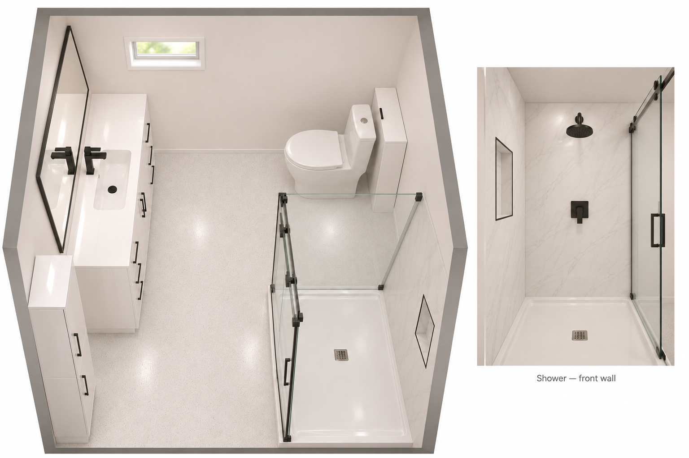

# Bathroom Concept v1 — Image Record

## Source

- Source ID: SRC-2026-089
- Type: AI-generated concept image (PNG)
- Archived: 2026-11-03
- Method: Built-in image generation during the bathroom design discussion
- Image: [Bathroom concept v1](../../documents/renovation/2026-11-03-bachelor-bathroom-concept-v1.png)
- Dimensions: 1536 × 1024 pixels
- SHA-256: `5e7b4a80859cc2dd36459f143404a8a96b424551128b767ff240fbce9698829f`
- Design context: [Current bathroom plan, SRC-2026-088](../../chat/2026/2026-11-03-renovation-bachelor-bathroom-plan.md)

This is the sole retained bathroom concept. It is an illustrative design image, not a measured construction plan or a photograph of completed work.

## Corrections

- Proportions are inaccurate.
- Shower fixture needs to be square.
- Niche needs to be wider and horizontal.
- Shower door opening needs to be on the left, facing it from the vanity.
