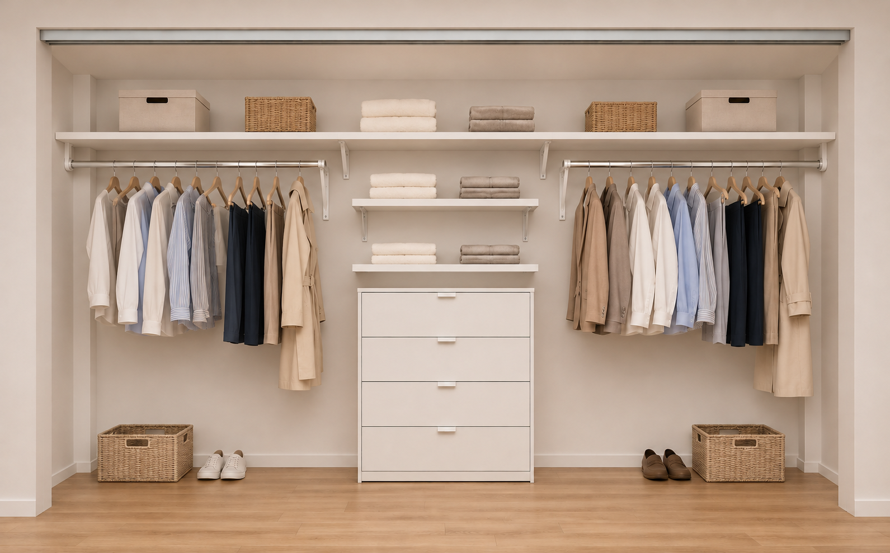

# Basement Renovation

Last updated: 2026-11-03 (related bathroom planning; room progress remains as reported November 2)

## Status

| Field | Value | Source |
|---|---|---|
| Status | In progress / new room nearly complete, homeowner-reported | SRC-2026-083 |
| Start date | Approximately October 19, 2026; inferred from “2 weeks ago” reported November 2 | SRC-2026-083 |
| Target date | Completion date not supplied; suspended ceiling and insulation remain | SRC-2026-083 |
| Budget | Not supplied | SRC-2026-083 |

Current sources: [November 2 progress and layout, SRC-2026-083](../../01-sources/chat/2026/2026-11-02-renovation-bachelor-started.md); [closet measurements, SRC-2026-084](../../01-sources/chat/2026/2026-11-02-renovation-bachelor-closet-concept.md); [revised preferred closet layout, SRC-2026-086](../../01-sources/chat/2026/2026-11-02-renovation-bachelor-closet-revised-layout.md).

## Scope

- Existing basement bachelor is treated as a legal rentable second unit in working files.
- Expansion into former garage space has created a new bachelor room, now nearly complete. (SRC-2026-083)
- Original goal: create a larger open living/dining area for the bachelor. [July plan, SRC-2026-021](../../01-sources/chat/2026/2026-07-07-renovation-priority-and-bachelor-expansion.md).
- The former L-shaped garage wrapped around the basement; the remaining bay now runs straight all the way to the back. The new room is to its left, with a small mechanical room further left, as described by the homeowner. Dimensions and parking capacity are unrecorded. (SRC-2026-083)
- The mechanical room contains the furnace, vacuum system and hot-water tank. Its only access is through the new bachelor room. (SRC-2026-083)
- Install a suspended ceiling with insulation in the new room, intended to retain access to ventilation ducts. This is the main remaining work identified by the homeowner. (SRC-2026-083)
- Remake the bachelor bathroom following the new room project; see the separate [bathroom plan](bathroom.md). Design planning recorded November 3; construction dates and budget not supplied. [SRC-2026-088](../../01-sources/chat/2026/2026-11-03-renovation-bachelor-bathroom-plan.md).

## Progress — Reported November 2, 2026

| Item | Status | Source |
|---|---|---|
| Walls | Complete, homeowner-reported | SRC-2026-083 |
| Flooring | Complete, homeowner-reported | SRC-2026-083 |
| Painting | Complete, homeowner-reported | SRC-2026-083 |
| Doors | Installed, homeowner-reported | SRC-2026-083 |
| Suspended ceiling and insulation | Remaining; installation date and materials unspecified | SRC-2026-083 |

Earlier permit/design and garage-condition questions below remain unresolved in the records. This progress report does not establish their completion or change the separate foundation-repair status or garage-ceiling deferral.

## Closet — Preferred Revised Concept

Sources: [Homeowner measurements, SRC-2026-084](../../01-sources/chat/2026/2026-11-02-renovation-bachelor-closet-concept.md); [revised layout preference and corner details, SRC-2026-086](../../01-sources/chat/2026/2026-11-02-renovation-bachelor-closet-revised-layout.md). Reported November 2, 2026.

| Item | Current record |
|---|---|
| Existing closet | Empty and painted |
| Interior dimensions | 127½ inches wide × 79¼ inches final clear height × 27–28¾ inches deep |
| Front opening | Four sliding panels, described as two sets; no central post/wall; side returns approximately 5–6½ inches each |
| Rear corners | Approximately 5 × 5 in square wall projections in both back corners, separate from the front returns; exact dimensions and vertical extent unverified |
| Preferred layout | One continuous top shelf to the actual side walls, behind the front returns and fitted around the rear projections; two smaller centre shelves beneath it, above a four-drawer chest; matching single hanging rods and open space below |
| Shelves | Contractor will make them, homeowner-reported. Material, thickness, depth, heights, corner cuts and single-piece versus joined fabrication remain to confirm |
| Rods and supports | Adjustable/telescopic rods proposed; outer wall sockets and back-wall shelf-and-rod brackets toward the centre are the support concept. Exact hardware, framing, anchors and spacing remain to confirm |
| Preliminary zone widths | Approximately 47 / 30 / 47 inches; total 124 inches, leaving 3½ inches overall for spacing/supports; not a cut list |
| Candidate furniture | IKEA VIHALS four-drawer chest; no selection or purchase recorded. PAX's stated minimum installation height exceeds the reported closet height |
| Status | Homeowner liked the revised preview and asked to record it as the preferred concept; furniture selection, construction details, budget and installation date remain unspecified |

Drawer placement depends on the actual clear opening with the sliding panels moved aside and the full drawer travel past doors/tracks. The contractor must confirm corner measurements, fabrication access, joins and supports before cutting. See the sources for the dated product research and remaining fit checks. Closet measurements do not establish the full room dimensions or completion of the room's remaining ceiling work.

Illustrative concept; sliding panels omitted to show the interior. Finishes, dimensions shown, corner fitting and supports are illustrative; the full-height depiction of the rear projections is unverified. [Revised rendering provenance and exact prompt, SRC-2026-087](../../01-sources/extractions/2026/2026-11-02-bachelor-closet-concept-v2-render.md). The [earlier rendering, SRC-2026-085](../../01-sources/extractions/2026/2026-11-02-bachelor-closet-concept-render.md) is retained as design history.

## Quotes

| Date | Contractor | Amount | Tax Included | Source | Status | Notes |
|---|---|---:|---|---|---|---|
|  |  |  |  |  |  |  |

## Tasks

| Task | Owner | Due Date | Source | Status | Notes |
|---|---|---|---|---|---|
| Install suspended ceiling with insulation in the new bachelor room | User | Not supplied | SRC-2026-083 | Remaining | Intended to keep ventilation ducts accessible; main remaining work identified November 2 |
| Confirm closet cut list, supports and drawer access | Contractor / Maxime | Before shelf fabrication | SRC-2026-086 | Pending | Check rear projections, one-piece versus joined top shelf, wall framing, rod supports and drawer clearance through sliding doors |
| Confirm with Terrebonne Urbanisme whether the garage-space conversion affects permits, use, or unit status | User | Before design spend (original target) | SRC-2026-008, SRC-2026-021 | Open in records | No approval update supplied with November 2 progress report |
| Document converted garage area and remaining parking/storage | User |  | SRC-2026-021, SRC-2026-083 | Partially documented | Straight bay, new room and mechanical-room access described; dimensions and parking/storage capacity unspecified |
| Review fire separation, CO safety, egress, insulation, heating, ventilation, sound separation, and ceiling-height requirements |  |  | SRC-2026-015, SRC-2026-021 | Open | May require designer, technologist, architect, or experienced general contractor |
| Confirm garage water/drainage and garage ceiling material issues are resolved or included in design |  | Before construction (original target) | SRC-2026-015, SRC-2026-021 | Open in records | November 2 progress report does not resolve these earlier design questions |
