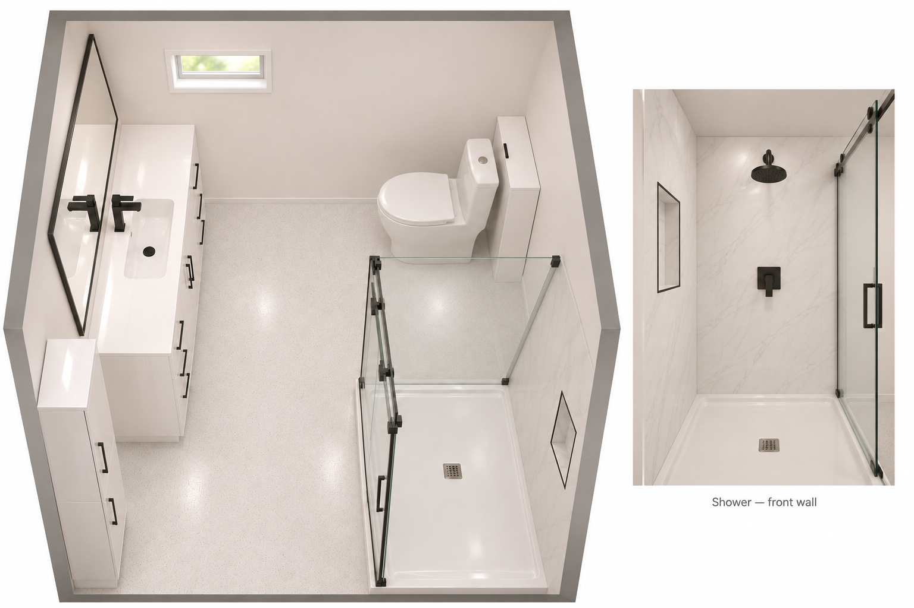

# Bachelor Bathroom Renovation

Last updated: 2026-11-05

Sources: [Measurements, layout and finishes, SRC-2026-088](../../01-sources/chat/2026/2026-11-03-renovation-bachelor-bathroom-plan.md); [product choices, comparisons and remaining purchases, SRC-2026-090](../../01-sources/chat/2026/2026-11-04-renovation-bachelor-bathroom-products.md).

Current orders: [Canac, SRC-2026-091](../../01-sources/extractions/2026/2026-11-05-renovation-canac-order-4005849329.md); [Bain Dépôt, SRC-2026-092](../../01-sources/extractions/2026/2026-11-05-renovation-bain-depot-order-4000176758.md); [Amazon purchase and Marcel credit, SRC-2026-093](../../01-sources/chat/2026/2026-11-05-renovation-amazon-shower-niche-order.md).

Earlier concept layout corrections: [SRC-2026-095](../../01-sources/chat/2026/2026-11-05-renovation-bathroom-model-corrections.md).

## Status

| Field | Value | Source |
|---|---|---|
| Status | Purchasing underway: shower/panels, vanity/top, linen cabinet, black faucet/accessories, ALEX mirror and Amazon niche ordered; Toledo and separate light/dimmer TBC | SRC-2026-090, SRC-2026-091, SRC-2026-092, SRC-2026-093 |
| Construction dates | Not supplied | SRC-2026-088 |
| Budget / quotes | Overall budget/quote unknown; known bathroom items 2,528.00 CAD before tax, excluding Amazon, labour and remaining materials | SRC-2026-091, SRC-2026-092, SRC-2026-093 |

## Scope

- Remake the bachelor bathroom with a corner shower, vanity and tall matching storage, rotated toilet, and shallow storage behind the toilet.
- Related work: [Bachelor room renovation](basement.md).

## Concept v2 — New Layout Study, November 5

[Open Concept v2](../../01-sources/documents/renovation/bathroom-concept-v2/dist/index.html) · [model assumptions and checks, SRC-2026-098](../../01-sources/extractions/2026/2026-11-05-bachelor-bathroom-model-v2.md) · [homeowner directions, SRC-2026-097](../../01-sources/chat/2026/2026-11-05-renovation-bathroom-concept-v2.md).

Separate comparison concept; the earlier model is preserved. This does not establish a final construction layout.

| Item | V2 arrangement |
|---|---|
| Entrance | Closed by default; opens inward toward shower with animated Open/Close button and angle slider |
| Linen | Rear-left corner, facing toilet; **handles left / hinges right when facing cabinet**, opening toward the rear wall; supersedes the intermediate right-handle request |
| Vanity / mirror | Along left wall beside linen, toward entrance; assumed ¾-in gap between top and linen |
| Hamper / hand towel | Front-left corner; towel fixture follows hamper |
| Light / ventilation controls | Front wall **left** of entrance above hamper, side by side: light dimmer left, vent switch right when facing the plate. Products and fixture compatibility TBC |
| Tool outlet | Left wall above front end of vanity, beside mirror; height/location provisional |

**Fit finding:** entrance-door sweep clears modeled shower/furniture. Rear-hinged linen doors conflict with the rear wall and assumed window/towel fittings during opening. Cabinet spacing and rear fittings need review; offsets would reduce the vanity/hamper space. Source: SRC-2026-098.

## Earlier Concept — Dimensions and Layout

Dimensions are in inches. Front is the entrance wall; left/right are as seen when entering. Fit remains to confirm on site. (SRC-2026-088)

| Item | Plan |
|---|---|
| Room | 89 wide × 86½ deep; ceiling 85 high |
| Entrance | Front wall toward the left; reported left wall segment 15¼ plus 2½ trim, Canac 88001678 Shaker door, 30 × 80 × 1⅜, one frosted pane, with Weiser Breton matte-black privacy lever 9GLC3310-069 (SRC-2026-095). Reverse inward swing toward the left, away from shower; 2½-inch casing with two recessed borders, white-painted wood grain, jambs/stops shown. Door trimming planned; final cut height missing, so model retains stock 80-inch placeholder. Fit/handing unverified |
| Shower | Front-right, nominal 48 along the right wall × 36 across the front wall; door opens on the left when facing it from the vanity. Dimensioned corner base 47¾ × 36 in; 1-in threshold, 2000-mm-high / 8-mm glass, end drain (SRC-2026-096; base sheet has conflicting dimensions) |
| Vanity and mirror | Ordered cabinet 1194 × 456 × 820 mm with 1215 × 465 mm top (SRC-2026-096), assembly flush to left and rear walls, facing right; ordered ALEX 36 × 28 mirror above (SRC-2026-092); mounting heights to confirm |
| Linen cabinet | Against left wall, 2-inch gap to front wall for door clearance; handles left / hinges right (SRC-2026-095). Reversible doors confirmed (SRC-2026-096); actual 90° travel to verify with bathroom door closed |
| Toilet and storage | Toilet at back-right, facing the left wall, moved a little toward the rear; model assumes 3 inches (SRC-2026-095). Shallow white storage against the right wall behind the tank; gap estimated at one foot or less, exact size/access unconfirmed |
| Hamper / trash can | White Sterilite Slim centred between linen and vanity top, approximately 0.71-inch gaps each side; black IKEA GANSJÖN between shower and toilet; selected for model, purchase unreported (SRC-2026-095) |
| Accessories / outlet | Rear-wall outlet centered above vanity end; hand-towel ring on left wall centred directly above hamper; rear towel bar moved left beneath window, clear of paper holder; robe hook on right wall over trash bin. Exact mounting positions to verify (SRC-2026-095) |
| Ventilation grille | Rectangular front-wall grille above linen cabinet; centralized ducted ventilation homeowner-reported. Model assumes 12 × 6 inches; actual dimensions/function unknown (SRC-2026-095) |
| Window | High on the back wall toward the left; small, two sliding panes, wider white frame/trim; dimensions unknown |

## Materials and Products

Finish direction: glossy white furniture with black handles, black fixtures, off-white walls, and white epoxy flooring with fine grey/dark-grey/black details. Fine speckling and a satin sheen are suggestions. Shower panels cover the solid front and right walls to the ceiling; the bathroom-facing sides remain clear glass. The square shower fixture/control goes on the front wall, with a vertical 12 × 24 niche in the long right interior wall. The November 5 correction (SRC-2026-095) supersedes the earlier horizontal preference. [SRC-2026-088](../../01-sources/chat/2026/2026-11-03-renovation-bachelor-bathroom-plan.md#materials-and-fixture-preferences).

### Shopping List

November 5: Canac and Bain Dépôt orders are documented; Amazon niche ordered per homeowner. Collection, delivery and settled payments remain unconfirmed. Count the Canac shower once alongside the earlier “obtained” report. Sources: [Canac, SRC-2026-091](../../01-sources/extractions/2026/2026-11-05-renovation-canac-order-4005849329.md); [Bain Dépôt, SRC-2026-092](../../01-sources/extractions/2026/2026-11-05-renovation-bain-depot-order-4000176758.md); [Amazon purchase and Marcel credit, SRC-2026-093](../../01-sources/chat/2026/2026-11-05-renovation-amazon-shower-niche-order.md). Earlier references: [initial references, SRC-2026-088](../../01-sources/chat/2026/2026-11-03-renovation-bachelor-bathroom-plan.md#product-references) and [product update, SRC-2026-090](../../01-sources/chat/2026/2026-11-04-renovation-bachelor-bathroom-products.md).

| Item | Product / link | Status / remaining check |
|---|---|---|
| Shower | [Canac Alaska KD3329, 48 × 36](https://www.canac.ca/canac/fr/2/p/douche-en-coin-alaska-a-base-surbaissee-finition-carree-noire-48-po-x-36-po/KD3329) | Ordered one, 835.00 CAD before tax (SRC-2026-091); ready for pickup. Reconciles earlier obtained report; no second purchase counted. Confirm collection and installation; archived component drawings in SRC-2026-096 establish glass/base sizes, with a base-sheet dimension conflict and reversible end drain |
| Shower stool | [Chormtok black HDPE stool, Amazon B0FR49WRFK](https://www.amazon.ca/dp/B0FR49WRFK) | Selected for model (SRC-2026-095), purchase unreported; near front shower wall. Diagram 16.9 × 12.6 × 16.5 high inches used; text table has conflicting width. Verify actual dimensions |
| Shower panels | [Canac Sapphire 33003746, white marble look, 48 × 96](https://www.canac.ca/canac/fr/2/p/panneau-mural-de-douche-marbre-blanc-48-po-x-96-po-sapphire/33003746) | Ordered two, 198.00 CAD before tax (SRC-2026-091); ready for pickup. Confirm cuts, full-height coverage and niche detail |
| Shower fixture | [Canac Brigitta 3051904, black, with hand shower](https://www.canac.ca/canac/fr/49/p/robinet-de-douche-avec-douchette-1-poignee-brigitta-noir/3051904) | Supplied reference; confirm square-head configuration, valve, included components and fit |
| Vanity | [Bain Dépôt Alder reference, nominal 48 × 18](https://www.baindepot.com/ensemble-meuble-lavabo-collection-alder.html?pid=16889) | Ordered VF4818-62GWH, 489.00 CAD before tax (SRC-2026-092); availability around November 16 holds entire order. Drawing: cabinet 1194 × 456 × 820 mm; vertical centre-door pulls. Verify site fit (SRC-2026-096) |
| Linen cabinet | [Bain Dépôt LF1614-62GWH, nominal 16-inch glossy white](https://www.baindepot.com/lingerie-de-plancher-16po-blanc-lustre-a-poignees-noires-lf1614-62gwh.html) | Ordered LF1614-62GWH, 379.00 CAD before tax (SRC-2026-092); requested handles left / hinges right when facing cabinet (SRC-2026-095); reversible doors confirmed by manufacturer (SRC-2026-096); verify 90° travel and entrance clearance with proposed 2-inch wall gap |
| Sink top | [Bain Dépôt Saxe porcelain rectangular-basin top, 48 × 18](https://www.baindepot.com/dessus-vanite-porcelaine-lavabo-rectangulaire-saxevt.html?pid=5938) | Ordered VT-SQ1207, 230.00 CAD before tax (SRC-2026-092); drawing: 1215 × 465 mm, 510 × 280 basin opening, 185 total depth including underside boss; verify cabinet/top and faucet compatibility (SRC-2026-096) |
| Sink faucet | [Bain Dépôt F-4021-3 family with drain](https://www.baindepot.com/robinet-de-lavabo-monotrou-avec-bonde-f-4021-3.html?pid=17728) | Ordered F-4021-3BK, matte black with drain, 89.00 CAD before tax (SRC-2026-092) |
| Toilet | [Costco SERA Toledo, TOLADATT](https://www.costco.ca/p/-/sera-toledo-1-piece-dual-flush-toilet/4000418914) | Provisional choice, TBC; 399 CAD reported by homeowner, tax/delivery treatment unspecified. Check rotated fit before purchase |
| Accessories | [Bain Dépôt SQ3004BK, four square black accessories](https://www.baindepot.com/ensemble-de-4-accessoires-carres-sq3004.html?pid=8162) | Ordered SQ3004BK, 99.00 CAD before tax (SRC-2026-092); confirm placements |
| Mirror | [Bain Dépôt ALEX 84-ALEX-90, 36 × 28](../../01-sources/extractions/2026/2026-11-05-renovation-bain-depot-order-4000176758.md) | Ordered, 209.00 CAD before tax (SRC-2026-092); integrated LED. Supersedes previous mirror options; confirm mounting/electrical placement |
| Shower niche | [Amazon B0DCZC7134](https://www.amazon.ca/dp/B0DCZC7134), Homevacious white stainless steel, nominal 12 × 24, two compartments | Ordered per homeowner (SRC-2026-093); identity from same-ASIN US listing. Amount/delivery unknown; vertical orientation selected (SRC-2026-095); confirm variant, framing and waterproofing |
| Used-towel hamper | [Sterilite Slim white, Walmart 6000206048323](https://www.walmart.ca/en/ip/STERILITE-ST-SLIM-LAUNDRY-HMPR/6000206048323) | Selected for model (SRC-2026-095), purchase unreported; 19½ × 12¼ × 24½ high, hinged lid and handles |
| Trash can | [IKEA GANSJÖN black 206.054.71](https://www.ikea.com/ca/en/p/gansjoen-trash-can-black-20605471/) | Selected for model (SRC-2026-095), purchase unreported; 17 cm diameter × 26 cm high, 3 L |
| Door / privacy lever | Canac Shaker 88001678 with [Weiser Breton 9GLC3310-069, matte black](https://www.rona.ca/en/product/weiser-breton-locking-door-lever-for-bed-or-bath-privacy-door-matte-black-9glc3310-069-09656126) | Homeowner-identified bathroom references (SRC-2026-095); handle purchase unreported. Door has one frosted pane; no hook on glass. Confirm machining, jambs, hinges and swing |
| Vanity light and dimmer | Four linked candidates below | Slim black direction accepted; light and compatible dimmer TBC |
| Behind-toilet storage | Product TBC | Shallow white unit; size after measuring the actual gap and tank/shutoff access |
| Wall paint and floor system | Products TBC | Off-white paint; white epoxy with fine dark details. Contractor to specify preparation/coating, ceramic overlay versus removal, and traction finish |

### Mirror and Vanity Light

Ordered **ALEX 84-ALEX-90, 36 × 28 inches**, with integrated LED lighting, **209.00 CAD before tax**. The revised model uses its two inset vertical LED strips and actual 900 × 700 × 45 mm dimensions (SRC-2026-095). This resolves the mirror selection and supersedes the earlier LETTAN / nominal 48-inch ALEX shortlist. [Order, SRC-2026-092](../../01-sources/extractions/2026/2026-11-05-renovation-bain-depot-order-4000176758.md). Earlier comparison remains in [SRC-2026-090](../../01-sources/chat/2026/2026-11-04-renovation-bachelor-bathroom-products.md#mirror-options).

A separate vanity light and compatible dimmer remain TBC; the mirror order does not establish that an additional light is selected or cancelled. The four earlier candidates are retained below. Each is dimmable with a compatible LED dimmer; 3000 K is warm white. Dimming does not establish adjustable colour temperature.

| Light / link | Width, inches | Colour temperature | Output | Dimmable |
|---|---:|---:|---:|---|
| [OVE Arjun — RONA](https://www.rona.ca/en/product/ove-decors-arjun-315-in-black-metal-and-acrylic-modern-style-vanity-light-arjun-vlblk-69375222) | 31½ | 3000 K, homeowner-confirmed | 1,200 lm | Yes |
| [Frederic 50105-BK — Bain Dépôt](https://www.baindepot.com/luminaire-pour-meuble-lavabo-au-del-50105-w.html?pid=18007) | 35¼, homeowner-confirmed | 3000 K | 2,200 lm, homeowner-confirmed | Yes |
| [Artika Bubble Bar — Costco](https://www.costco.ca/p/-/artika-bubble-bar-integrated-led-vanity-light/4000259907) | 27 | 3000 K | 1,300 lm | Yes |
| [Artika Subway — Costco](https://www.costco.ca/p/-/artika-subway-27-inch-vanity-led-light-fixture/100671758) | Approximately 27 | 3000 K | 1,200 lm for black 27VAN-SU-MB | Yes |

The Subway value comes from [Artika's black-model page](https://artika.ca/products/subway-led-bathroom-vanity-light); Costco's mixed-variant listing says 1,900 lm alongside nickel copy. Frederic uses the homeowner's corrected values despite inconsistent retailer documents. Full evidence and comparison: [SRC-2026-090](../../01-sources/chat/2026/2026-11-04-renovation-bachelor-bathroom-products.md#vanity-light-comparison).

The earlier LETTAN recommendation is superseded by the ALEX order. Coordinate the selected 36 × 28-inch mirror, electrical connection and any separate light within the 85-inch ceiling. No separate light or dimmer order is documented. (SRC-2026-090, SRC-2026-092)

### Toilet Fit and Comparison

SERA Toledo is provisionally selected at the homeowner-reported 399 CAD. Listed dimensions are 26.8 inches deep × 14.6 wide × 29.5 high, with a 16.5-inch bowl height before the seat and nominal 12-inch rough-in. Check these against the actual outlet, rotated tank position, vanity clearance and storage access. Costco lists the seat, bolts/caps and wax ring as included.

[Appollo Neil](https://www.costco.ca/p/-/appollo-neil-1-piece-elongated-toilet/4000395998) remains the comparison alternative at the same reported price. The useful differences and remaining specification/parts questions are in [SRC-2026-090](../../01-sources/chat/2026/2026-11-04-renovation-bachelor-bathroom-products.md#toilet-comparison-and-provisional-choice).

### Remaining Materials and Supply Responsibilities

Confirm the following with the contractor before ordering installation supplies. These are planning checks; final quantities and supply responsibility remain open. [Checklist source, SRC-2026-090](../../01-sources/chat/2026/2026-11-04-renovation-bachelor-bathroom-products.md#remaining-purchases-and-contractor-checks).

- Shower valve/components, drain, panel backing, compatible adhesive/sealant/trims and the complete waterproof niche detail.
- Vanity drain/trap/connections, supply lines and shutoffs; toilet flange condition/height and connection parts, accounting for the included kit.
- Mirror/accessory mounting hardware, chosen light's compatible dimmer and electrical placement.
- Off-white paint/primer and the floor preparation/coating/traction system.
- Shallow white storage behind the tank and final accessory locations.

## Earlier 3D Concept — Retained for Comparison

[Open the offline 3D viewer](../../01-sources/documents/renovation/bathroom-concept/dist/index.html) · [GLB model](../../01-sources/documents/renovation/bathroom-concept/dist/bathroom.glb) · [Source, assumptions and rebuild instructions — SRC-2026-094](../../01-sources/extractions/2026/2026-11-05-bachelor-bathroom-model.md).

Generated November 5 using the recorded 89 × 86½-inch room, 85-inch ceiling and ordered materials, including the 36 × 28-inch ALEX mirror. Rotate, zoom, use doorway/overhead/vanity/shower presets, and hide walls to inspect the layout. The HTML works offline and can export the model or a PNG of the current view. The [concept folder](../../01-sources/documents/renovation/bathroom-concept/README.md) contains the generator, product references and public `dist/index.html` / `dist/bathroom.glb`. Publish only `01-sources/documents/renovation/bathroom-concept/dist/`. The address-free viewer is titled “Basement bathroom” with “Current concept · Layout, materials and fixtures”.

Updated with all [November 5 layout corrections, SRC-2026-095](../../01-sources/chat/2026/2026-11-05-renovation-bathroom-model-corrections.md): vanity flush to left/rear walls, linen 2 inches from front wall, reversed linen doors, toilet moved rearward, rear-wall outlet above vanity, hand towel over hamper, towel bar shifted left with hanging towels, hook above bin, vertical niche, front-wall vent, correct mirror light pattern and selected hamper/bin. Closed frosted-glass Shaker door and matte-black Weiser Breton privacy lever are included; the original five presets remain. Added the black Chormtok stool near the front shower wall and complete doorway casing, jambs, stops and schematic hinges. Latest refinement adds two recessed trim borders/wood grain and corrects the shower base, end drain, enclosure, vanity/top/basin and skirted Toledo form using [archived specifications, SRC-2026-096](../../01-sources/extractions/2026/2026-11-05-bathroom-product-dimensions.md).

Latest approved update centres the hamper and hand-towel fixture in the remaining furniture gap and gives the vanity a glossy white recessed base. A simplified model sweep clears the cabinet doors to 90° with the room door closed; check actual hinges on site. Published fixture envelopes now follow SRC-2026-096; detailed contours and finish textures remain schematic. End drain is provisionally near the front beneath the removable stool, pending plumbing verification. Window dimensions, mounting heights, exact fixture placement and behind-toilet storage are provisional; door swing, final door cut height, outlet position and installation clearances remain to verify. The toilet and shower fixture remain provisional selections. The model records a visualization, not approval of final construction dimensions.

## Earlier Bathroom Concept v1

Earlier retained concept image; the interactive model above adds the November 5 purchases. [Image record, SRC-2026-089](../../01-sources/extractions/2026/2026-11-03-bachelor-bathroom-concept-v1-render.md). The written plan above records the current preferences; the image is illustrative.

- Proportions are inaccurate.
- Shower fixture needs to be square.
- Earlier request: wider horizontal niche; superseded November 5 by the vertical niche (SRC-2026-095).
- Shower door opening needs to be on the left, facing it from the vanity.

## Orders and Costs — November 5

- Canac 4005849329: **1,747.60 CAD including tax**, of which shower and shower panels are **1,033.00 before tax**. Ready for Laval yard pickup; collection unconfirmed. Bathroom door model is now identified; complete allocation of the three ordered doors remains unconfirmed. C-Ment panels are for Marcel and tracked as a pending invoice credit, not bathroom materials.
- Bain Dépôt 4000176758: **1,718.88 CAD including tax**, all six bathroom items. Whole order awaits vanity availability around **November 16** for Mascouche store pickup; await ready notification.
- Known bathroom items total **2,528.00 CAD before tax** (1,033.00 + 1,495.00), excluding the Amazon niche and remaining purchases/labour. Whole Canac and Bain Dépôt orders total **3,466.48 CAD including tax**, including doors and Marcel's panels; this is not a bathroom-only total.
- Amazon niche: homeowner-reported order; price, quantity and delivery date unknown. Vertical orientation selected November 5 (SRC-2026-095); confirm variant and installation dimensions.
- Checkout methods are recorded; settled payment evidence remains unconfirmed. Overall bathroom quote, budget and construction dates remain unspecified.

Sources: [Canac, SRC-2026-091](../../01-sources/extractions/2026/2026-11-05-renovation-canac-order-4005849329.md); [Bain Dépôt, SRC-2026-092](../../01-sources/extractions/2026/2026-11-05-renovation-bain-depot-order-4000176758.md); [Amazon purchase and Marcel credit, SRC-2026-093](../../01-sources/chat/2026/2026-11-05-renovation-amazon-shower-niche-order.md). [Cost and allocation record](../../04-finance/renovation-costs.md#november-5--material-orders-and-pending-credit).

## Tasks

| Task | Owner | Due Date | Source | Status | Notes |
|---|---|---|---|---|---|
| Resolve v2 linen-door clearance and compare layouts | Maxime / contractor | Before layout selection / installation | [SRC-2026-098](../../01-sources/extractions/2026/2026-11-05-bachelor-bathroom-model-v2.md) | Pending | Rear-hinged linen doors conflict with the rear wall and assumed window/towel fittings; review cabinet offset, rear fittings and resulting vanity/hamper spacing. Confirm dimmer/fixture compatibility, outlet placement, actual door/hinge travel, final cut height and existing plumbing/ventilation assumptions |
| Confirm room, window, entrance and furniture measurements | Maxime / contractor | Before layout finalization | SRC-2026-088 | Pending | Include inward door swing, shower access and passage clearances |
| Confirm Toledo choice, rotated toilet and storage fit | Maxime / contractor | Before toilet/storage purchase | SRC-2026-088, SRC-2026-090 | Pending | Toledo remains provisional; measure outlet/tank position, passage clearance and storage gap, retain tank/shutoff access, and confirm parts support |
| Coordinate ordered mirror and decide separate light/dimmer | Maxime / contractor | Before electrical placement / further purchase | SRC-2026-090, SRC-2026-092 | Pending | ALEX 84-ALEX-90 is ordered; coordinate 36 × 28 mirror within 85-inch ceiling. Four separate light candidates retained |
| Confirm shower and niche installation details | Contractor | Before installation | SRC-2026-088, SRC-2026-090, SRC-2026-093 | Pending | Brigitta configuration/valve, finished installation height, base-sheet dimension conflict, reversible end-drain rough-in/orientation, base/wall build-up, left-side opening; verify vertical niche dimensions, framing and waterproofing (SRC-2026-095) |
| Finalize remaining products and supply responsibilities | Maxime / contractor | Before further ordering | SRC-2026-090, SRC-2026-092 | Pending | Cabinet/top fit, accessory placements, plumbing/mounting supplies, shallow storage, paint and floor system; black faucet code now confirmed F-4021-3BK |
| Obtain bathroom scope, quote and schedule | Maxime / contractor | Not supplied | SRC-2026-088, SRC-2026-090 | Pending | Include labour, materials, quantities, inclusions and who buys each item; retain receipts as purchases occur |
| Collect Canac order and confirm receipt | Maxime | Ready November 5; promptly | SRC-2026-091 | Pending | Laval yard pickup, 3400 boul. Curé-Labelle; one shower purchase recorded |
| Watch Bain Dépôt readiness and collect order | Maxime | Availability around November 16, not confirmed pickup date | SRC-2026-092 | Pending | Entire order held for vanity; Mascouche store, 198 montée Masson |
| Retain Amazon details and reconcile checkout charges | Maxime | When available | SRC-2026-091, SRC-2026-092, SRC-2026-093 | Pending | Amazon amount/quantity/delivery and settled card payments unconfirmed |
